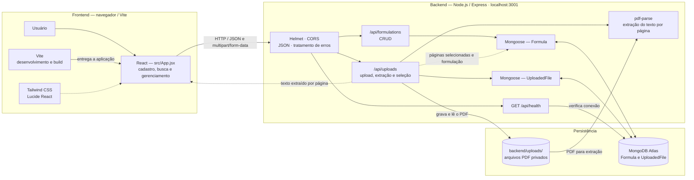

# Arquitetura do FormuLAB

## Fluxo de cadastro por PDF

1. A interface envia um PDF para `POST /api/uploads`.
2. A API valida o arquivo, grava-o em `backend/uploads/` e registra seus
   metadados na coleção `UploadedFile`.
3. `GET /api/uploads/:id/text` lê o PDF do disco e usa `pdf-parse` para devolver
   o texto selecionável por página à interface.
4. Após a revisão, `PATCH /api/uploads/:id/selection` guarda as páginas
   selecionadas no documento `UploadedFile`.
5. `POST /api/uploads/:id/formulation` cria um documento `Formula` com os dados
   revisados, o texto das páginas selecionadas e a referência ao arquivo de
   origem.

## Fluxo de consulta e gerenciamento

A interface consulta `GET /api/formulations` para carregar os registros. A API
também oferece consulta individual (`GET /api/formulations/:id`), criação
direta (`POST /api/formulations`), atualização parcial
(`PATCH /api/formulations/:id`) e exclusão (`DELETE /api/formulations/:id`).
Essas operações usam o modelo `Formula`, persistido no MongoDB Atlas.

## Limites atuais

- O frontend chama a API em `http://localhost:3001`; o Vite entrega a interface,
  mas não atua como proxy da API.
- Os PDFs ficam no disco local e não são expostos por uma rota pública.
- A API ainda não tem autenticação; o backend é destinado ao desenvolvimento
  local.
- O histórico de alterações exibido na interface é mantido em estado local e
  não é persistido pela API atual.
